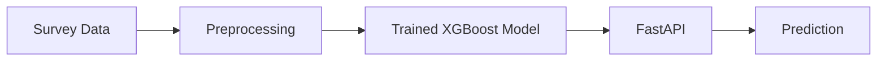

# Student Depression Prediction

## Problem Statement

Depression among students is an important mental health concern. It can affect personal well-being, daily functioning, and academic experiences. Research has continued to examine the prevalence of depression among university students and the factors associated with student mental health.

This project applies machine learning to survey data to predict reported student depression. It treats the task as a binary classification problem, predicting `Yes` or `No` based on personal, academic, and lifestyle information.
 
## Dataset Description

The project uses the **Student Depression Detection Dataset, Version 2**, published on Mendeley Data.

- **Source:** [Mendeley Data](https://data.mendeley.com/datasets/xn9cb5zpgg/2)
- **DOI:** [10.17632/xn9cb5zpgg.2](https://doi.org/10.17632/xn9cb5zpgg.2)
- **License:** CC BY 4.0
- **Records:** 4,464
- **Features:** 12 input features and one target variable

The target variable, `depression`, indicates whether a student reported depression.

## Exploratory Data Analysis (EDA) Summary

The EDA examined dataset structure, data quality, numerical and categorical feature distributions, and relationships between features and the target variable. Visualizations and feature analysis helped identify patterns in the student data and better understand which variables were most relevant to prediction.

For detailed analysis and visualizations, see Section 3: Exploratory Data Analysis in the [Jupyter notebook](notebooks/student_depression_prediction.ipynb).

## Modeling Approach and Metrics

Three classification models were trained and evaluated:

- Logistic Regression
- Decision Tree
- XGBoost

The dataset was divided into training, validation, and test sets using a stratified 60/20/20 split. Hyperparameter tuning was performed for all three models using the validation set. The final model was selected based on validation performance and evaluated on the test set.

The selected XGBoost model uses the following hyperparameters:

- `eta`: 0.1
- `max_depth`: 6
- `min_child_weight`: 1

**Test Set Performance**

| Metric | Score |
|---|---:|
| Accuracy | 0.994 |
| Precision | 0.996 |
| Recall | 0.983 |
| F1 Score | 0.990 |
| ROC AUC | 0.999 |

## Project Architecture

The project follows a simple workflow from survey data to prediction.



The training script preprocesses the data, trains the model, and saves the model and feature vectorizer. The FastAPI application loads these saved artifacts and generates predictions from incoming requests.

## Project Structure

```text
student-depression-prediction/
├── api-deployment-screenshots/
│   ├── health-check.png
│   ├── prediction-test-one.png
│   └── prediction-test-two.png
├── data/
│   └── Student_Depression_Dataset.csv
├── models/
│   └── student_depression_model.pkl
├── notebooks/
│   └── student_depression_prediction.ipynb
├── .gitignore
├── Dockerfile
├── predict.py
├── pyproject.toml
├── README.md
├── serve.py
├── train.py
└── uv.lock
```

## Running the Project

### Local Setup

Clone the repository and install the project dependencies.

```bash
git clone https://github.com/mnygit/student-depression-prediction.git
cd student-depression-prediction
uv sync
```

### Train the Model

Run the training script to train the XGBoost model and save the model and feature vectorizer.

```bash
uv run python train.py
```

The saved model is written to `models/student_depression_model.pkl`.

### Run the API

Start the FastAPI application.

```bash
uv run uvicorn serve:app --host 0.0.0.0 --port 9696
```

The API is available at `http://localhost:9696`.

Open `http://localhost:9696/docs` to explore and test the API through Swagger UI.

The /predict endpoint accepts student information as a JSON request. See the API Usage Example below for a sample request and response.

**Health Check**

```bash
curl http://localhost:9696/health
```

Expected response:

```json
{"status":"ok"}
```

### Run with Docker

Build the Docker image.

```bash
docker build -t student-depression-prediction .
```

Start the container.

```bash
docker run -d \
  --name student-depression-api \
  -p 9696:9696 \
  student-depression-prediction
```

**Open the FastAPI documentation.**

Open a web browser and visit `http://localhost:9696/docs`.

The Swagger UI page displays the available API endpoints and allows the reviewer to test predictions.

**Verify that the API is running.**

Run the following command in the terminal.

```bash
curl http://localhost:9696/health
```
Expected response:

```json
{"status":"ok"}
```

## API Usage Example

Send a POST request to `/predict` with student information.

```bash
curl -X POST "http://localhost:9696/predict" \
  -H "Content-Type: application/json" \
  -d '{
    "gender": "Female",
    "age": 22,
    "family_background": "Middle class",
    "relationship_status": "Single",
    "marital_status": "Unmarried",
    "living_style": "Bachelor",
    "current_semester": 5,
    "cgpa": 3.5,
    "friend_circle": "Yes",
    "health_condition": "Normal",
    "cost_without_study": 8000,
    "home_division": "Dhaka"
  }'
```

Example response:

```json
{
  "depression_prediction": "No",
  "depression_probability": 0.0005
}
```

The probability represents the model's predicted probability of the `Yes` class. Actual predictions depend on the submitted input.

**To stop and remove the container after testing, run:**

```bash
docker stop student-depression-api
docker rm student-depression-api
```

## Limitations and Next Steps

The model relies heavily on the `health_condition` feature. The dataset documentation does not clearly explain how this feature relates to the depression target. During feature importance analysis it was learned that removing this feature substantially reduced model performance.

Future work will continue to investigate this feature further and evaluate the model on an independent dataset.

This project is an educational machine learning exercise and is not intended for clinical diagnosis or as a substitute for professional evaluation.

## Dataset Attribution

Student Depression Detection Dataset, Version 2. Mendeley Data. https://doi.org/10.17632/xn9cb5zpgg.2. Licensed under [CC BY 4.0](https://creativecommons.org/licenses/by/4.0/).